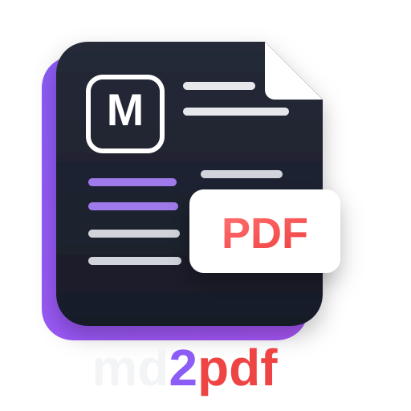

<div align="center">
  
  <p align="center">
    <a href="https://www.npmjs.com/package/@amitdevx/md2pdf"></a>
    <a href="https://www.npmjs.com/package/@amitdevx/md2pdf"></a>
    <a href="https://github.com/amitdevx/md2pdf/blob/main/LICENSE"></a>
  </p>
  <p align="center">
    <b><a href="https://amitdevx.tech/projects/amitdevx-md2pdf">Project Page</a></b> &nbsp;&middot;&nbsp;
    <b><a href="https://www.npmjs.com/package/@amitdevx/md2pdf">npm</a></b> &nbsp;&middot;&nbsp;
    <b><a href="https://github.com/amitdevx/md2pdf">GitHub</a></b>
  </p>
</div>

Convert Markdown to PDF with Mermaid diagrams, KaTeX math, Obsidian syntax, syntax highlighting, raw HTML rendering, batch processing, secure file sandboxing, file merging, watch mode, and Table of Contents generation. Available as a CLI and Node.js API.

## Installation

```bash
# Install globally (for CLI usage)
npm install -g @amitdevx/md2pdf
md2pdf init

# Or use locally within a project (for programmatic usage)
npm install @amitdevx/md2pdf
npx md2pdf init
```

Run `md2pdf doctor` to verify your environment, dependencies, and Chromium browser availability. For details, see the [Getting Started guide](docs/getting-started.md).

## CLI Usage

The most common way to use `md2pdf` is via the command line.

### Basic Conversion

```bash
md2pdf document.md
```

Generates `document.pdf` in the same directory.

### Common Examples

Specify an explicit output path and theme:
```bash
md2pdf document.md -o output.pdf --theme github
```

Enable Table of Contents and page numbers:
```bash
md2pdf document.md --toc --page-numbers
```

Batch convert multiple files:
```bash
md2pdf docs/*.md --output-dir dist/
```

Merge multiple Markdown files into a single PDF:
```bash
md2pdf chapter1.md chapter2.md --merge -o book.pdf
```

Read from standard input:
```bash
cat document.md | md2pdf --stdin -o output.pdf
```

Watch mode for continuous rebuilding on save:
```bash
md2pdf document.md --watch
```

For the full list of options, flags, and exit codes, see the [CLI Reference](docs/cli-reference.md).

## Node.js API Usage

`md2pdf` can be imported as an ES module in Node.js applications:

```javascript
import { convert } from '@amitdevx/md2pdf';

const result = await convert({
  input: 'document.md',
  output: 'output.pdf',
  theme: 'github',
  toc: true,
  pageNumbers: true
});

console.log(`Rendered ${result.pageCounts} pages to ${result.outputPath}`);
```

For programmatic configuration options and types, see the [API Reference](docs/api.md).

## Built-in Themes

`md2pdf` includes 7 built-in themes:

* `default`: Clean standard document theme
* `academic`: Formal serif layout suitable for research papers
* `dracula`: Dark mode theme with high-contrast palette
* `github`: Light GitHub-flavored markdown style
* `nord`: Cool-toned Nordic palette
* `obsidian-dark`: Dark theme matching Obsidian desktop app
* `obsidian-light`: Light theme matching Obsidian desktop app

Custom CSS themes can also be provided using `--theme ./custom.css`. See the [Themes Guide](docs/themes.md).

## Documentation Directory

All detailed documentation is organized in the `docs/` directory:

* **[Getting Started](docs/getting-started.md)**: Installation, system prerequisites, and quick start guide.
* **[CLI Reference](docs/cli-reference.md)**: Command-line flags, options, exit codes, and usage examples.
* **[API Reference](docs/api.md)**: Node.js programmatic API, options, and TypeScript definitions.
* **[Configuration](docs/configuration.md)**: Persistent configuration files, global settings, and profiles.
* **[Themes](docs/themes.md)**: Using built-in themes and authoring custom CSS themes.
* **[Plugins](docs/plugins.md)**: Extending md2pdf lifecycle via the plugin API.
* **[Obsidian Support](docs/obsidian.md)**: Guide to Obsidian callouts, embeds, tags, and wiki-links.
* **[Mermaid & Math](docs/mermaid.md)**: Diagram syntax, rendering options, and KaTeX math notation.
* **[Error Catalog](docs/errors.md)**: Error codes, diagnostic recommendations, and JSON error schema.
* **[Security & SSRF](docs/security.md)**: Network isolation, URL guard, and local file sandboxing model.
* **[Architecture](docs/architecture.md)**: Internal pipeline design, caching mechanisms, and performance notes.
* **[Contributing](docs/contributing.md)**: Guidelines for local development, testing, and pull requests.

## License

MIT License. See [LICENSE](LICENSE) for details.
