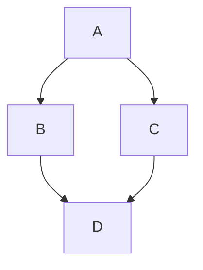
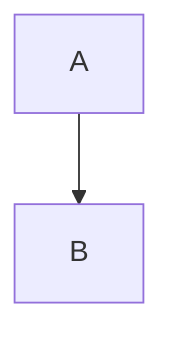

# Mermaid Diagrams

md2pdf renders supported [Mermaid](https://mermaid.js.org/) diagrams locally using Playwright, producing vector graphics without external CDN dependencies. Diagram appearance and pagination can vary with complexity; review large diagrams in the generated PDF.

## Supported Diagrams

All standard Mermaid diagrams are supported, including:

- **Flowcharts** (`graph`, `flowchart`)
- **Sequence Diagrams** (`sequenceDiagram`)
- **Class Diagrams** (`classDiagram`)
- **State Diagrams** (`stateDiagram-v2`)
- **Entity Relationship Diagrams** (`erDiagram`)
- **User Journey** (`journey`)
- **Gantt Charts** (`gantt`)
- **Pie Charts** (`pie`)
- **Requirement Diagrams** (`requirementDiagram`)
- **Gitgraph Diagrams** (`gitGraph`)
- **Mindmaps** (`mindmap`)
- **Timelines** (`timeline`)
- **XY Charts** (`xychart-beta`)

Just use the standard markdown code block syntax with the `mermaid` language identifier:

````markdown

````

## Theming

Mermaid diagrams are automatically themed based on your active md2pdf theme:

| md2pdf Theme | Mermaid Theme |
|-------------|--------------|
| `default` | `default` |
| `github` | `base` |
| `obsidian-light` | `default` |
| `obsidian-dark` | `dark` |
| `dracula` | `dark` |
| `nord` | `neutral` |
| `academic` | `neutral` |

### Overriding Themes

You can override the theme for all diagrams using the CLI or Frontmatter, or for specific diagrams using the code fence metadata.

**1. Per-diagram override:**
````markdown

````

**2. Global override via Frontmatter:**
```yaml
---
mermaid:
  theme: neutral
---
```

**3. Global override via CLI:**
```bash
md2pdf input.md --mermaid-theme neutral
```

**Custom Themes:**
You can also specify custom CSS theme strings for Mermaid if you're using advanced configuration files (`md2pdf.config.ts`), and the CLI `--mermaid-theme` flag will correctly accept your custom theme names.

## Sizing and Layout Constraints

By default, Mermaid diagrams scale based on their intrinsic dimensions bounded by the page container width and height. Complex or wide diagrams may require custom maxWidth or maxHeight settings to fit cleanly on a single page.

You can override these bounding constraints globally:

**Via Frontmatter:**
```yaml
---
mermaid:
  maxWidth: 80%
  maxHeight: 400px
---
```

## Error Handling & Timeouts

By default, invalid Mermaid syntax causes conversion to fail with an error. To render a styled error callout box in place of the invalid diagram instead of failing the conversion, use the `--permissive-mermaid` flag.

Diagram rendering times out if a diagram takes too long to process. The default timeout is 30,000ms (30 seconds).

You can configure this timeout or disable Mermaid processing:

**Via Frontmatter:**
```yaml
---
mermaid:
  enabled: false
  timeout: 15000
---
```

**Via CLI:**
```bash
md2pdf input.md --mermaid-timeout 15000
```

## High-Quality Vector Output

Mermaid diagrams are rendered with `deviceScaleFactor: 2` (High-DPI) and injected as `<svg>` elements into the final PDF.

## Version Parity (v10 vs v11)

md2pdf bundles `mermaid.min.js` v11. If you previously used md2pdf versions with Mermaid v10, layout differences may appear in some structural charts (such as `erDiagram` or `classDiagram`), which may render with adjusted padding in v11.

Additionally, md2pdf preprocesses common syntax patterns like unescaped quotes in labels to improve compatibility when exporting complex diagrams.
